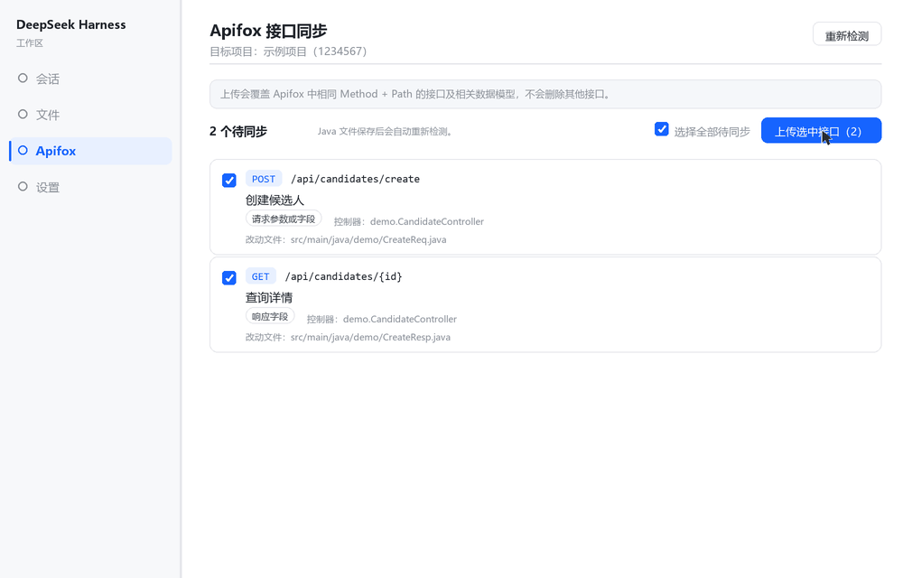

# Apifox 接口同步

一个面向 Java 项目的 DeepSeek Harness 插件：监听 Git 工作区中的 Java 改动，找出受影响的 Controller 接口，并在用户明确点击后把选中的接口同步到 Apifox。



## 功能

- 识别 Solon 的 `@Controller`、`@Mapping`、`@Get`、`@Post`、`@Put`、`@Delete`、`@Body`、`@Param`、`@Multipart`，以及常用 Spring 映射注解。
- Controller 自身的路径、方法、参数、响应类型、Javadoc / Swagger 说明发生变化时，列出受影响接口。
- 请求或响应 DTO（包括泛型、嵌套类与父类字段）发生变化时，反向定位引用它的接口，并区分“请求参数或字段”“响应字段”。
- 侧边栏入口 + 主面板：主面板提供完整清单、勾选上传和结果反馈；输入框上方同步显示待同步数量与目标项目，也可一键上传全部待同步接口。
- 上传前会弹出确认框，明确显示目标 Apifox 项目、将覆盖的接口数量与覆盖语义；覆盖操作不会静默发生。
- 上传前重新扫描并校验接口指纹，避免把扫描后又过期的内容传出去。
- 调用 Apifox 官方 `POST /v1/projects/{projectId}/import-openapi`，接口与数据模型均使用 `OVERWRITE_EXISTING`。因此仅修改字段说明也会覆盖更新，不需要注释字段再恢复。
- 始终设置 `deleteUnmatchedResources: false`，只上传选中的接口，不删除 Apifox 中其他资源。

> **覆盖提醒**：这是“覆盖所有字段”策略，不是智能合并。Apifox 中手工修改的同名接口说明、Mock、示例等可能被源码内容覆盖。插件不会自动上传，必须由用户点击。

## 配置

插件优先读取环境变量：

- `APIFOX_ACCESS_TOKEN`
- `APIFOX_PROJECT_ID`

未设置环境变量时，会复用项目根目录 `.spring-api-helper.json` 中已有的 `apiKey`、`projectId` 和 `projectName`。令牌只在 Host 中使用，不会返回浏览器或写入生成的 OpenAPI。

可选：在项目根目录新建 `.apifox-sync.json`，指定项目或目录 ID（不要把令牌写入此文件）：

```json
{
  "projectId": "1234567",
  "projectName": "示例项目",
  "targetEndpointFolderId": 123456,
  "targetSchemaFolderId": 234567
}
```

也支持 `targetBranchId` 和 `moduleId`。未配置目录 ID 时使用 Apifox 的默认匹配/导入目录行为。

## 使用

1. 在当前项目目录打开 DSH 会话。
2. 修改并保存 Controller 或相关 DTO。
3. 输入框上方会出现待同步提示；打开左侧 **Apifox** 面板可查看 Method、Path、接口说明、改动类型和来源文件。
4. 核对页面顶部的目标项目，勾选接口后点击 **上传选中接口**。
5. 上传成功的当前指纹会标记为“已同步”；后续再次修改会重新变为待同步。

## 当前边界

- 检测范围是相对 Git `HEAD` 的未提交改动，包括未跟踪 Java 文件；提交后如需重新上传，可修改源码再次产生差异。
- “已同步”指纹仅保存在当前 DSH 进程内。重启后，只要改动仍相对 `HEAD` 存在，就会重新显示为待同步。
- 默认读取 `src/main/java`。首版面向普通 `class` DTO；`record`、接口作为模型、复杂自定义泛型解析可能不完整。
- 删除 Java 接口或模型不会远程删除 Apifox 资源。
- 静态常量路径支持同类中的 `static final String`；跨类动态拼接路径可能无法展开。
- 插件直接生成 OpenAPI，不调用 IDEA 的右键动作，因此不依赖 IDEA 是否处于打开状态。

## 验证

```sh
pnpm run check
```

测试使用临时 Git 仓库和模拟 Apifox 响应，不会上传真实项目。
